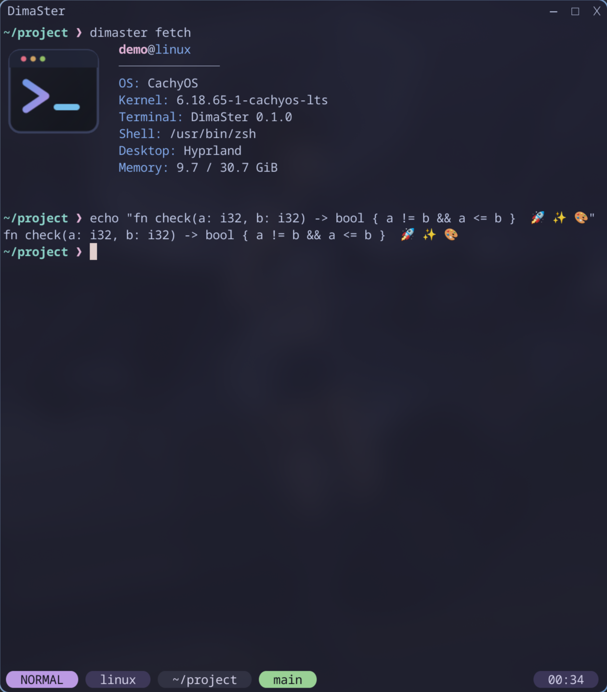
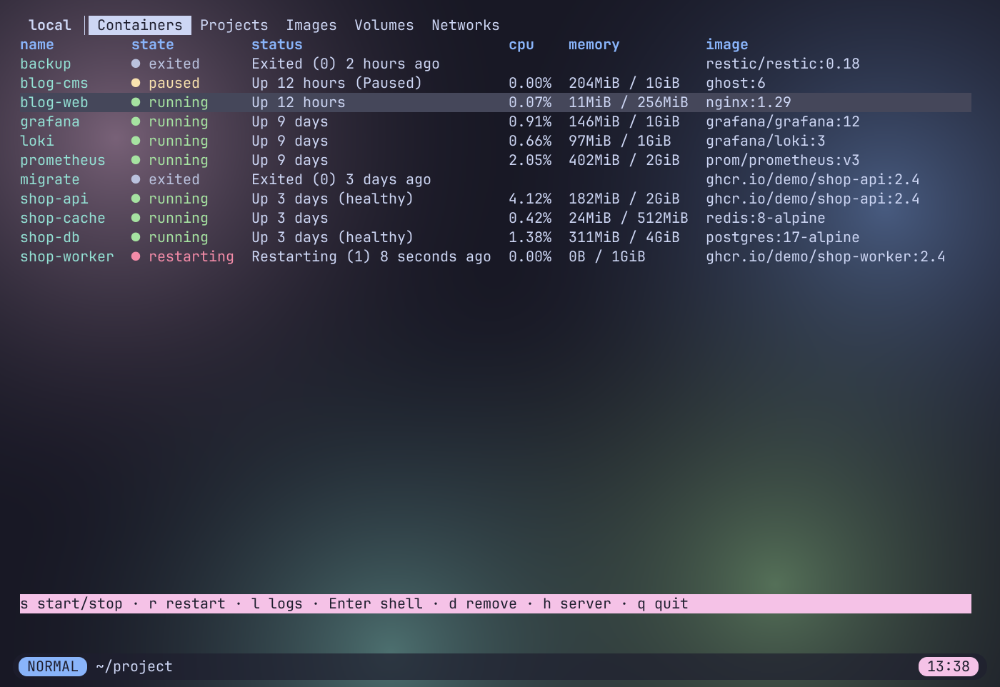
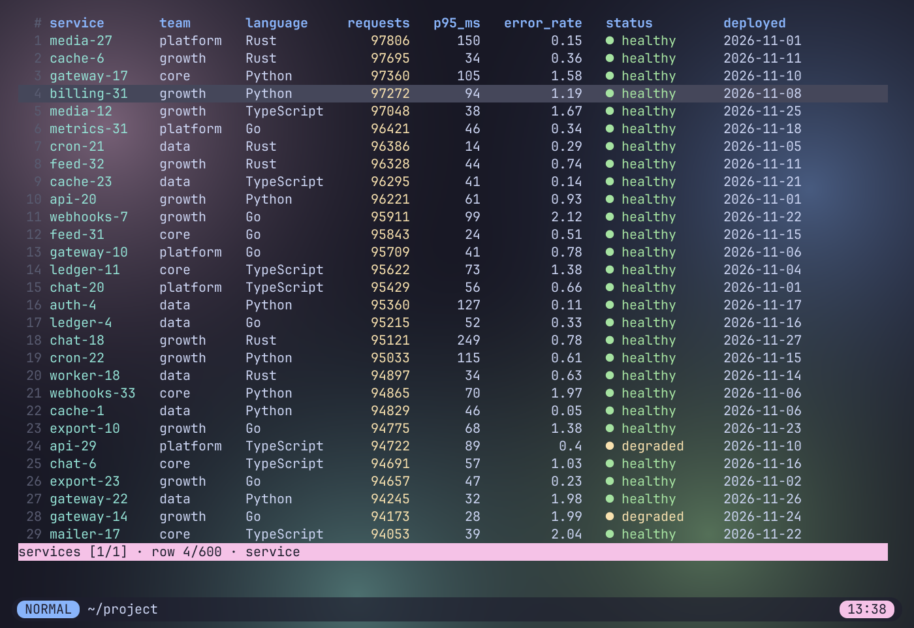
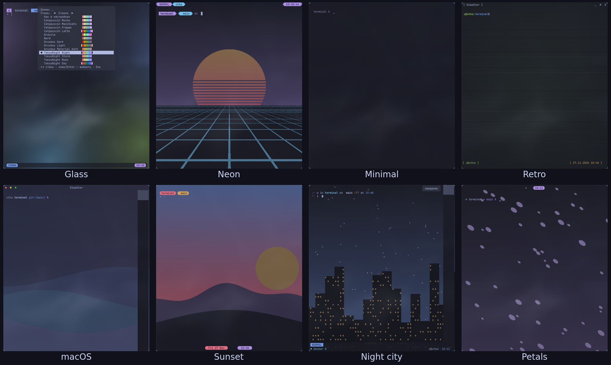
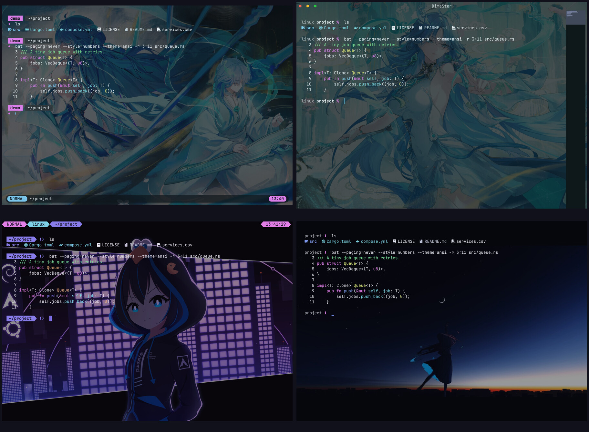
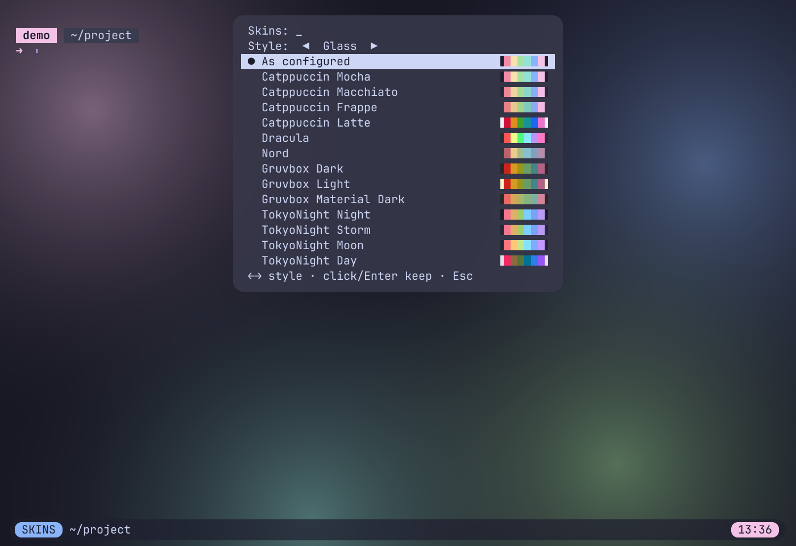
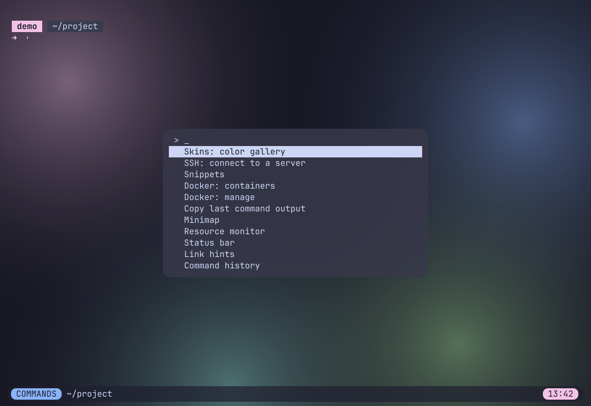

# DimaSter

**English** · [Русский](README.ru.md)

[](https://github.com/Utkautka1/DimaSter/actions/workflows/ci.yml)
[](LICENSE)

A fast, GPU-accelerated Linux terminal emulator written in Rust (`wgpu` + `winit`), featuring modular **Lua 5.4** configuration, full **Kitty keyboard & graphics protocols**, **COLR/CBDT color emoji**, **shell integration**, **vi mode**, **command palette**, and a built-in **Lua status bar**.



| `dimaster docker` | `dimaster view services.csv` |
|---|---|
|  |  |

## Features

- **GPU Rendering (`wgpu`)**: Vulkan primary backend with automatic OpenGL fallback; works on Wayland and X11.
- **Custom Font Rasterizer & Shaping**: `rustybuzz` text shaping with ligatures, OpenType `features`, per-style font families (`bold`, `italic`, `bold_italic`), Nerd Font icon fitting, RTL (bidi), CJK, IME preedit, and **CBDT + COLR v0/v1 color emoji**.
- **Full Keyboard & Input Support**:
  - Complete **Kitty Keyboard Protocol** (all 5 flags: disambiguate, event types, alternate keys, all keys, associated text).
  - **Unsafe Paste Protection**: warns before pasting multi-line text without bracketed paste or dangerous control sequences.
  - **Mouse Selection**: word/line/block (`Alt+drag`), auto-scroll when dragging past viewport edges, primary/clipboard `copy_on_select`, and OSC 8 hyperlinks (`Ctrl+click`).
- **Graphics Protocols**:
  - **Kitty** (`t=d/f/t/s` including POSIX shared memory, `a=f`/`a=a` frame animations, `U=1` Unicode placeholders for `tmux` + `yazi`, `x/y/w/h` cropping).
  - **Sixel**, **iTerm2** (`OSC 1337`), and built-in `dimaster icat` (images and video via `ffmpeg`) + `dimaster fetch`.
- **Memory-Efficient Scrollback**: RLE + style-run packed history compression with full reflow on resize.
- **Layered Lua 5.4 Configuration**: hot-reloaded on save, with Catppuccin Mocha & blur/Starship defaults and built-in migration wizard from Ghostty, Kitty, and Alacritty (`dimaster --setup`) + Ghostty theme support.
- **Out-of-the-Box Smart Shell (No ZSH Plugins Needed)**: works across `zsh`, `bash`, `fish`, and `sh`:
  - **Command Syntax Highlighting**: validates commands live against `$PATH`, built-ins, and disk paths (green/red) plus flags, strings, variables, operators, and comments.
  - **Typo Correction & Ghost Autosuggestions**: suggests corrections (`cs` → `cd`, press `Ctrl+Right` / `Ctrl+End` to fix) and finishes commands from persistent history (`Right` / `End` for full line, `Ctrl+Right` word-by-word).
  - **Auto-Pairing & Colored Tools**: auto-closes `() [] {} "" ''` (`smart.autopair`), injects Catppuccin `LS_COLORS` with colored `ls`/`eza` (`smart.color_ls`), and runs `dimaster fetch` on shell startup (`smart.startup_fetch`).
  - **Fuzzy File & Directory Pickers**: built-in `fzf`-style file inserter (`Ctrl+Shift+T`) and `zoxide`-style frequent directory jumper (`Ctrl+Shift+G`), plus fuzzy-searchable command history (`Ctrl+Shift+H`).
- **Productivity Modes & Widgets**:
  - Command Palette (`Ctrl+Shift+P`), Scrollback Search (`Ctrl+Shift+F`), Vi Mode (`Ctrl+Shift+Space`), Link Hints (`Ctrl+Shift+U`), Command History (`Ctrl+Shift+H`, `Ctrl+Y` copies output), File Picker (`Ctrl+Shift+T`), Directory Jumper (`Ctrl+Shift+G`), Minimap (`Ctrl+Shift+M`), Resource Monitor (`Ctrl+Shift+O`), Status Bar (`Ctrl+Shift+B`), Sudo Fix (`Ctrl+Shift+S`), Presentation Mode (`Ctrl+Shift+Z`).
  - Lua plugin API (`~/.config/dimaster/plugins/*.lua`) and CLI remote control (`dimaster ctl`).

## Installation

### One-Command Install (Linux x86_64 and aarch64, no Rust required)

```sh
curl -fsSL https://raw.githubusercontent.com/Utkautka1/DimaSter/main/install.sh | sh
```

This downloads the latest release binary to `~/.local/bin/dimaster`, installs the desktop entry and icon, registers `xterm-dimaster` terminfo if `tic` is available, and creates the default settings in `~/.config/dimaster` (existing ones are left alone). If missing, JetBrainsMono Nerd Font and [starship](https://starship.rs) are installed from their official releases with checksum verification; your shell files are not edited, so add `eval "$(starship init zsh)"` (or the line for your shell) to use its prompt. Set `DIMASTER_NO_EXTRAS=1` for the `sh` process to skip them. Distribution packages create the settings on first launch and do not install these extras.

To uninstall:

```sh
./install.sh --uninstall
```

### Build from Source

Dependencies: Rust toolchain, `fontconfig`, `libxkbcommon`, `wayland` / `x11` / `xcb` development headers, Vulkan loader (or Mesa OpenGL), and optionally `ffmpeg` for video/WebP/JPEG in `icat`.

```sh
git clone https://github.com/Utkautka1/DimaSter.git
cd DimaSter
./install.sh
```

Or run directly with Cargo:

```sh
cargo run --release -p dimaster
```

### Packaging (Arch / CachyOS, Debian / Ubuntu, Fedora / openSUSE)

Prebuilt packages for every major Linux distribution are published on [GitHub Releases](https://github.com/Utkautka1/DimaSter/releases):

- **Arch Linux / CachyOS (`pacman`)**:
  ```sh
  # Direct pacman install from Release:
  curl -LO https://github.com/Utkautka1/DimaSter/releases/latest/download/dimaster-0.4.0-1-x86_64.pkg.tar.zst
  sudo pacman -U dimaster-0.4.0-1-x86_64.pkg.tar.zst
  ```
  Or build locally via AUR-ready `PKGBUILD` ([packaging/aur/PKGBUILD](packaging/aur/PKGBUILD) or prebuilt [packaging/aur/dimaster-bin/PKGBUILD](packaging/aur/dimaster-bin/PKGBUILD)):
  ```sh
  cd packaging/aur && makepkg -si
  ```
- **Debian / Ubuntu / Linux Mint (`.deb`)**:
  ```sh
  curl -LO https://github.com/Utkautka1/DimaSter/releases/latest/download/dimaster_0.4.0_amd64.deb
  sudo apt install ./dimaster_0.4.0_amd64.deb
  ```
  Or build locally: `./packaging/deb/build-deb.sh`
- **Fedora / RHEL / openSUSE (`.rpm`)**:
  ```sh
  curl -LO https://github.com/Utkautka1/DimaSter/releases/latest/download/dimaster-0.4.0-1.x86_64.rpm
  sudo dnf install ./dimaster-0.4.0-1.x86_64.rpm
  ```
  Or build locally: `./packaging/rpm/build-rpm.sh`

The following are available starting with version 0.2.0:

- **Any distribution (AppImage)**: download `DimaSter-<version>-<arch>.AppImage` from Releases, then
  ```sh
  chmod +x DimaSter-*.AppImage && ./DimaSter-*.AppImage
  ```
- **aarch64**: `tar.gz`, `deb`, `rpm` and AppImage are published for ARM as well.
- **NixOS / Nix** (flake, not yet verified by the maintainer):
  ```sh
  nix run github:Utkautka1/DimaSter
  ```
- **Flatpak** (experimental, not on Flathub, not yet verified): the shell runs on the host through `flatpak-spawn`, so shell integration is not injected.
  ```sh
  flatpak-builder --user --install --force-clean build-flatpak packaging/flatpak/io.github.Utkautka1.DimaSter.yml
  ```

- **Docker** (x86_64): the window uses the host display and GPU; the shell runs *inside the container*, so your host programs are not visible there.
  ```sh
  docker pull ghcr.io/utkautka1/dimaster:latest
  ./packaging/docker/run.sh
  ```
  Without a display the image can still run commands: `docker run --rm ghcr.io/utkautka1/dimaster --headless ls`. Settings and history are kept in `~/.local/share/dimaster-docker`. Build locally: `docker build -f dimaster.dockerfile -t dimaster .` and `DIMASTER_IMAGE=dimaster ./packaging/docker/run.sh`.

## Skins

Press `Ctrl+Shift+K` to browse 800+ built-in color schemes and 8 complete looks with live preview. No config editing.

A look changes more than colors: the status bar and its contents, widgets, window frame, cursor, panels, starship prompt and a procedurally drawn background.



Your own pictures become looks too: drop them into `~/.local/share/dimaster/backgrounds/` and the colors are taken from the image.



<sub>The wallpapers shown above are not shipped with DimaSter and are not covered by its MIT license; rights belong to their authors.</sub>

| Skin gallery (`Ctrl+Shift+K`) | Command palette (`Ctrl+Shift+P`) |
|---|---|
|  |  |

In the gallery: `↑`/`↓` or wheel picks a color scheme, `←`/`→` switches the look, typing searches, click or `Enter` keeps the choice, `Esc` reverts. "As configured" brings your own settings back. Details: [docs/lua/themes/skins.md](docs/lua/themes/skins.md).

## Usage

```sh
dimaster                       # open terminal with $SHELL
dimaster -e htop               # run a specific command
dimaster --headless ls -la     # render offscreen and print text
dimaster --setup               # run first-time config & import wizard
dimaster icat image.png        # display image/GIF/video in terminal
dimaster fetch                 # built-in system info (customizable via fetch.lua)
dimaster view a.csv b.json     # CSV, JSON, Parquet, Arrow, Excel, SQLite…: SQL, fuzzy search, plots, view.lua (docs/lua/view.md)
dimaster docker                # containers, compose, images, volumes, networks; local and SSH (docs/lua/docker.md)
dimaster ctl info              # query or control a running window
dimaster ssh-terminfo u@host   # install xterm-dimaster terminfo on a remote server
```

## Keybindings & Modes

All defaults; every one can be rebound in Lua ([docs/lua/settings/keys.md](docs/lua/settings/keys.md)).

### Windows, panels and tools

| Shortcut | Action |
|---|---|
| `Ctrl+Shift+N` | New window in the same directory |
| `Ctrl+Enter` | Toggle fullscreen |
| `Ctrl+Shift+P` | Command palette |
| `Ctrl+Shift+K` | Skin gallery |
| `Ctrl+Shift+E` | SSH hosts from `~/.ssh/config` |
| `Ctrl+Shift+I` | Snippets |
| `Ctrl+Shift+D` | Docker containers (`Ctrl+L` logs, `Ctrl+S` start/stop, `Ctrl+R` restart) |
| `Ctrl+Shift+T` | Fuzzy file picker |
| `Ctrl+Shift+G` | Jump to a frequent directory |
| `Ctrl+Shift+H` | Searchable command history (`Ctrl+Y` copies output) |
| `Ctrl+Shift+M` / `O` / `B` | Minimap / Resource monitor / Status bar |
| `Ctrl+Shift+Z` | Presentation mode |
| `Ctrl+Shift+,` | Reload configuration |

### Text, scrollback and search

| Shortcut | Action |
|---|---|
| `Ctrl+Shift+C` / `Ctrl+Shift+V` | Copy / Paste |
| `Shift+Insert`, middle click | Paste primary selection |
| `Ctrl+Shift+X` | Copy the output of the last command |
| Drag / `Alt` + drag | Select / Block selection |
| `Shift` + mouse | Bypass program mouse capture |
| `Ctrl+Click` | Open a link or a folder |
| `Ctrl+Shift+U` | Link hints |
| `Ctrl+Shift+F` | Search scrollback (`Ctrl+R` toggles regex) |
| `Ctrl+Shift+Space` | Vi mode (`hjkl`, `w b`, `0 $`, `g G`, `v V`, `y`, `/`, `q`) |
| `Shift+PageUp` / `PageDown`, wheel | Scroll by page / lines |
| `Shift+Home` / `Shift+End` | Top / bottom of scrollback |
| `Ctrl+Shift+Up` / `Down` | Previous / next prompt |
| `Ctrl+=` / `Ctrl+-` / `Ctrl+0` | Font size: bigger / smaller / reset |

### Shell helpers

| Shortcut | Action |
|---|---|
| `Right` / `End` | Accept the autosuggestion |
| `Ctrl+Right` | Accept the next word, or fix a mistyped command |
| `Ctrl+Shift+S` | Add `sudo` |

## Configuration

DimaSter stores modular Lua 5.4 configs under `~/.config/dimaster/` (hot-reloaded automatically):

```text
~/.config/dimaster/
├── init.lua              entry point
├── lib/                  layers.lua, merge.lua
├── settings/             appearance, font, window, effects, behavior, keys
├── themes/               custom and imported themes
├── plugins/*.lua         user Lua plugins
├── profiles/             desktop/<de>.lua, session/<wayland|x11>.lua, ssh.lua, presentation.lua
├── hosts/<hostname>.lua  per-machine overrides
└── local.lua             personal overrides (applied last, untouched by --setup)
```

Layers merge top-to-bottom: `settings` -> `profiles` -> `hosts` -> `local`.
Full Lua reference: [docs/lua/README.md](docs/lua/README.md).

## Development & Tests

```sh
cargo test --workspace
cargo clippy --workspace --all-targets -- -D warnings
cargo bench -p dimaster-grid
```

## Architecture

| Crate | Responsibility |
|---|---|
| `dimaster-vt` | Streaming VT/ANSI escape sequence parser |
| `dimaster-grid` | Terminal state, screen, compressed scrollback, reflow, graphics state |
| `dimaster-pty` | PTY spawning and process management |
| `dimaster-font` | Font discovery, `rustybuzz` shaping, outline & COLR/CBDT rasterizer |
| `dimaster-render` | `wgpu` renderer, glyph atlas, bidi, shader pipeline |
| `dimaster-image` | PNG, GIF, and Sixel decoders (+ `ffmpeg` fallback) |
| `dimaster-config` | Lua 5.4 config loader, Ghostty/Kitty/Alacritty importer, plugins |
| `dimaster-limits` | Safety limits and internal values, adjustable from Lua (`limits`) |
| `dimaster-i18n` | Built-in localization (`en`, `ru`, extensible via Lua) |
| `dimaster` | Application window, input, modes, CLI, session restore |

Architecture diagrams: [docs/UML.md](docs/UML.md).

## License

[MIT](LICENSE)
