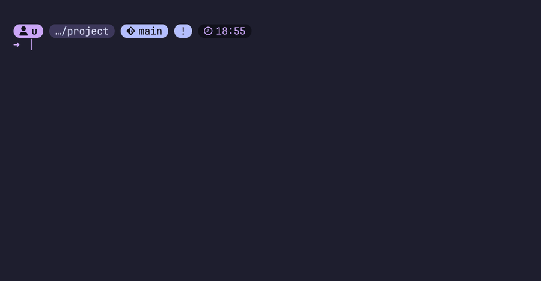
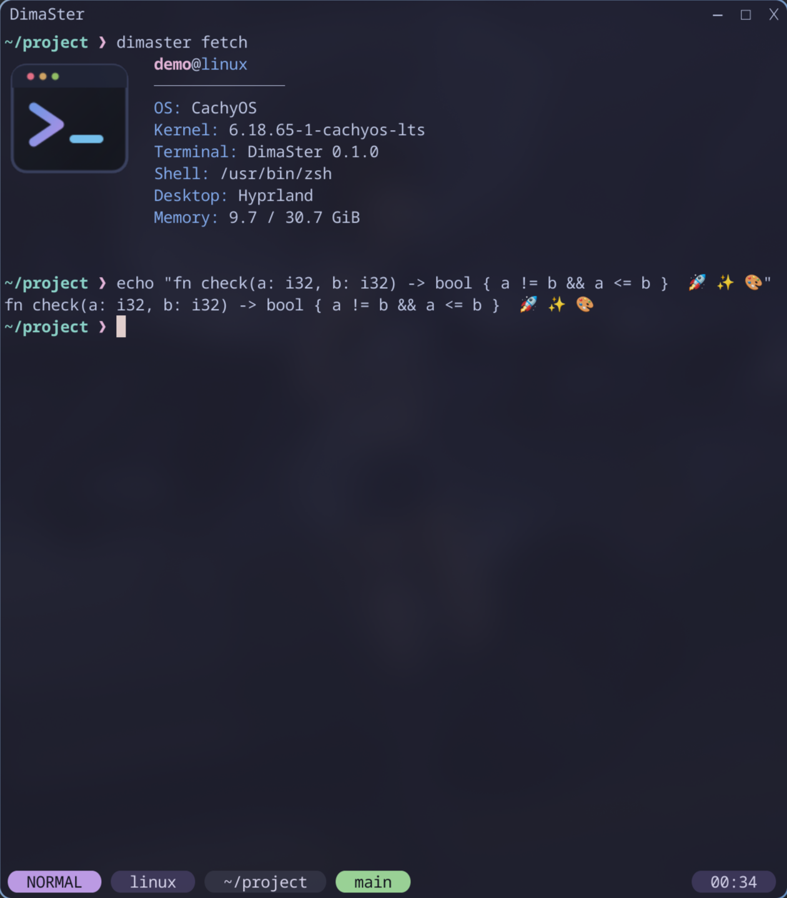
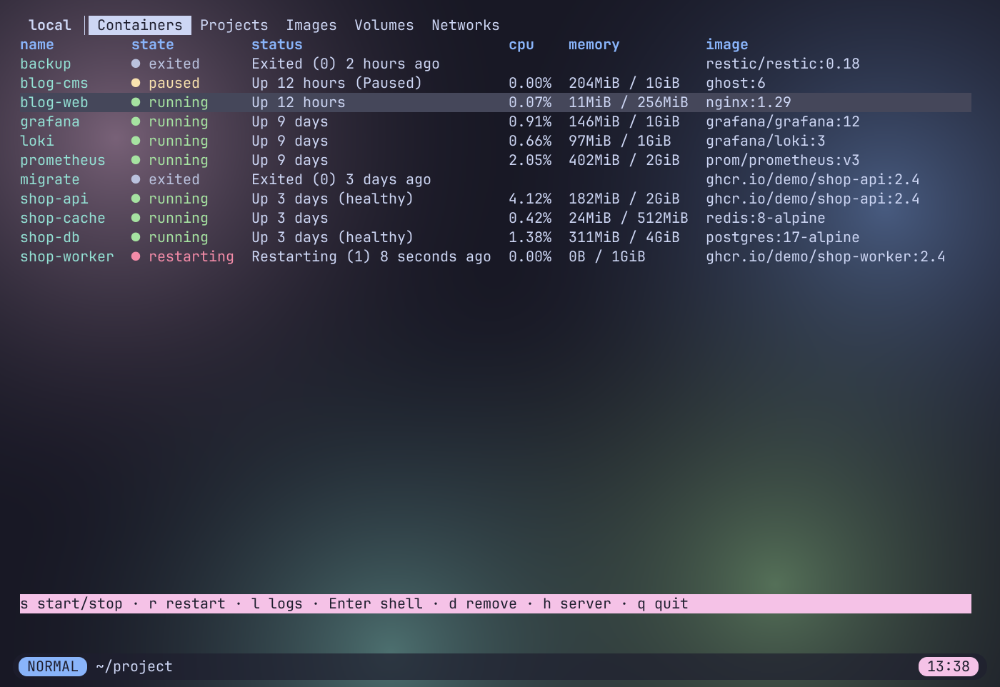
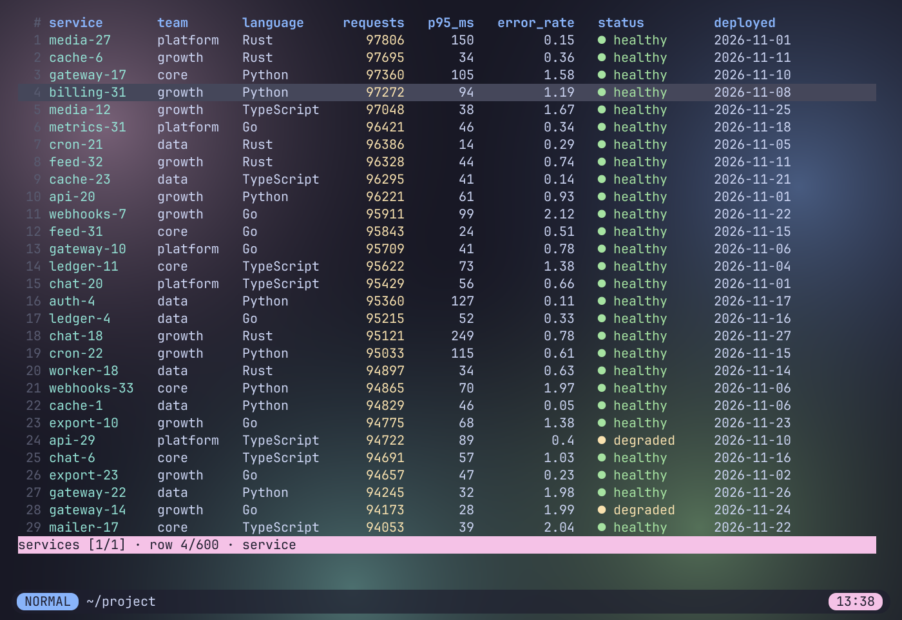
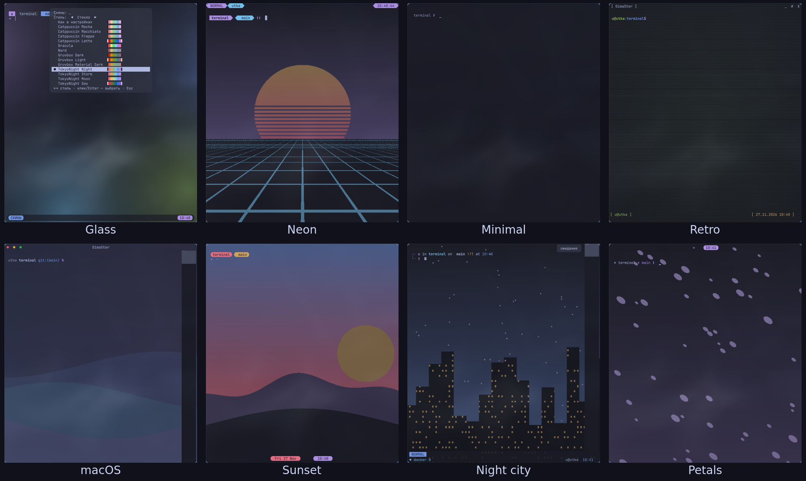
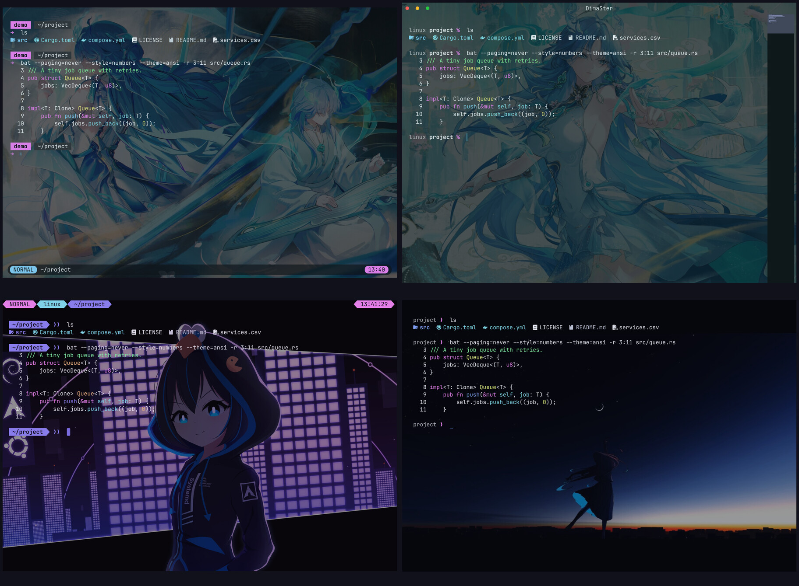
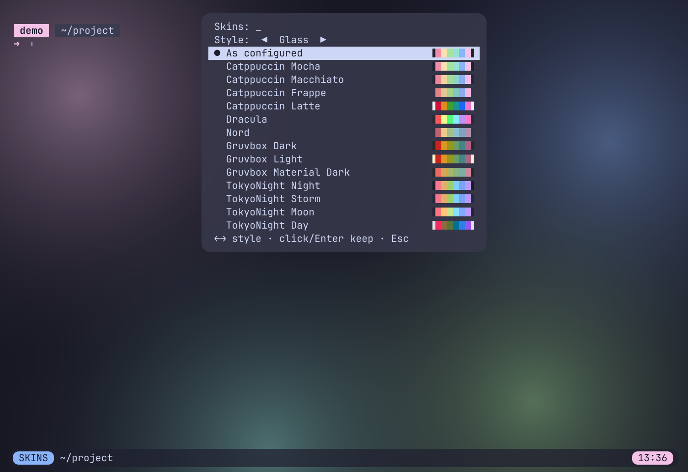
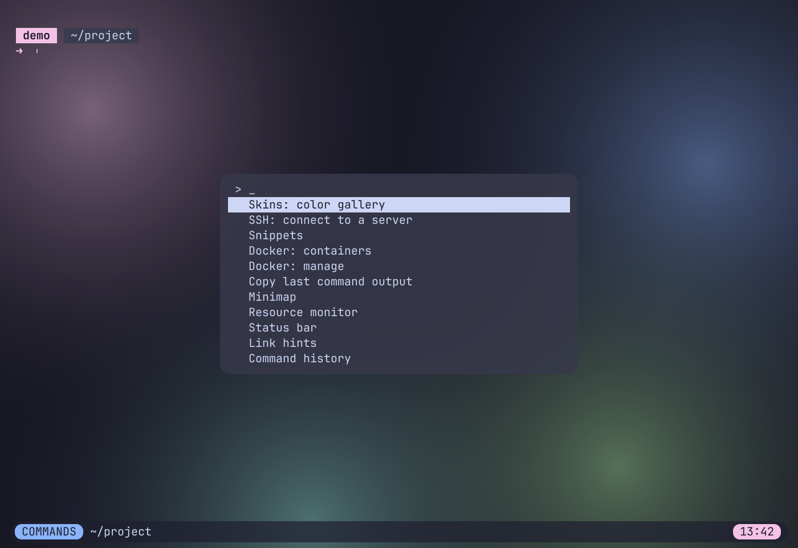

<p align="center">
  
</p>

<h1 align="center">DimaSter</h1>

<p align="center">
  Быстрый нативный терминал для Linux с отрисовкой на видеокарте, удобный сразу после установки.<br>
  Всё настраивается на <code>Lua</code>.
</p>

<p align="center">
  <a href="#возможности">О проекте</a> ·
  <a href="https://github.com/Utkautka1/DimaSter/releases/latest">Скачать</a> ·
  <a href="docs/lua/README.md">Документация</a> ·
  <a href="CONTRIBUTING.ru.md">Участие</a> ·
  <a href="#разработка">Разработка</a>
</p>

<p align="center">
  <b>Русский</b> · <a href="README.md">English</a>
</p>

<p align="center">
  <a href="https://github.com/Utkautka1/DimaSter/actions/workflows/ci.yml"></a>
  <a href="LICENSE"></a>
</p>

Быстрый эмулятор терминала для Linux на Rust с отрисовкой на видеокарте (`wgpu` + `winit`). Настраивается на **Lua 5.4**, поддерживает **протоколы Kitty** (клавиатура и графика), **цветные эмодзи**, интеграцию с shell, vi-режим, палитру команд и свою строку статуса. Поставил — и удобно сразу, без плагинов shell.





| `dimaster docker` | `dimaster view services.csv` |
|---|---|
|  |  |

## Возможности

- **Отрисовка на видеокарте:** Vulkan, при отсутствии — OpenGL; Wayland и X11.
- **Текст:** лигатуры (`rustybuzz`), OpenType-признаки, отдельные шрифты для начертаний, значки Nerd Font, письмо справа налево, CJK, ввод через IME, цветные эмодзи (CBDT, COLR v0/v1).
- **Ввод:** полный протокол клавиатуры Kitty; предупреждение перед опасной вставкой; выделение словами, строками и блоком (`Alt` + протяжка); ссылки OSC 8 (`Ctrl` + щелчок).
- **Картинки:** Kitty (включая анимацию и `tmux` + `yazi`), Sixel, iTerm2; `dimaster icat` показывает картинки и видео (через `ffmpeg`).
- **История прокрутки** хранится сжато и переносится по ширине при изменении окна.
- **Удобный shell без плагинов** (`zsh`, `bash`, `fish`, `sh`):
  - подсветка набираемой команды и проверка, существует ли она;
  - подсказки из истории и исправление опечаток (`cs` → `cd`);
  - автозакрытие скобок и кавычек, цветной `ls`;
  - выбор файла (`Ctrl+Shift+T`), переход в частую папку (`Ctrl+Shift+G`), поиск по истории (`Ctrl+Shift+H`).
- **Своё вместо плагинов:** меню по `Tab` (команды, флаги, файлы), поиск по истории стрелкой `↑`, сокращения и алиасы из Lua для всех shell — [подробнее](docs/lua/settings/native.md).
- **Помощь при ошибке:** нет прав — подскажет `sudo`; опечатка — похожую команду; программа не установлена — команду поиска пакета.
- **Режимы и панели:** палитра команд, поиск по истории прокрутки, vi-режим, метки на ссылках, миникарта, монитор ресурсов, строка статуса, режим презентации.
- **Расширение:** плагины на Lua (`~/.config/dimaster/plugins/*.lua`) и управление из консоли (`dimaster ctl`).

## Установка

### Одной командой (Linux x86_64 и aarch64, Rust не нужен)

```sh
curl -fsSL https://raw.githubusercontent.com/Utkautka1/DimaSter/main/install.sh | sh
```

Скачивает бинарник последнего релиза в `~/.local/bin/dimaster`, ставит ярлык, значок и описание терминала `xterm-dimaster` (если есть `tic`).

В конце установки `install.sh` создаёт `~/.config/dimaster` с настройками по умолчанию. Если нашлись настройки Ghostty, kitty или Alacritty, мастер предложит перенести их. Уже существующие настройки не заменяются. При установке пакетом (`deb`, `rpm`, `pacman`, AppImage) папка создаётся при первом открытии окна.

Скрипт также ставит, если их нет, шрифт **JetBrainsMono Nerd Font** (в `~/.local/share/fonts`) и [starship](https://starship.rs) (в `~/.local/bin`) из их официальных релизов с проверкой контрольной суммы. Ваши файлы shell он не меняет: чтобы включить приглашение starship, добавьте, например, в `~/.zshrc` строку `eval "$(starship init zsh)"`. Без дополнений: `curl -fsSL …/install.sh | DIMASTER_NO_EXTRAS=1 sh`. Пакеты (`deb`, `rpm` и другие) шрифт и starship не ставят.

Удалить:

```sh
./install.sh --uninstall
```

### Пакеты

Готовые пакеты лежат в [релизах](https://github.com/Utkautka1/DimaSter/releases).

| Система | Команды |
|---|---|
| Arch, CachyOS | `curl -LO https://github.com/Utkautka1/DimaSter/releases/latest/download/dimaster-0.4.1-1-x86_64.pkg.tar.zst` и `sudo pacman -U dimaster-0.4.1-1-x86_64.pkg.tar.zst` |
| Debian, Ubuntu, Mint | `curl -LO https://github.com/Utkautka1/DimaSter/releases/latest/download/dimaster_0.4.1_amd64.deb` и `sudo apt install ./dimaster_0.4.1_amd64.deb` |
| Fedora, openSUSE | `curl -LO https://github.com/Utkautka1/DimaSter/releases/latest/download/dimaster-0.4.1-1.x86_64.rpm` и `sudo dnf install ./dimaster-0.4.1-1.x86_64.rpm` |
| Любая | `DimaSter-<версия>-<архитектура>.AppImage`: `chmod +x` и запустить |

Для ARM публикуются `tar.gz`, `deb`, `rpm` и AppImage. Рецепты для Arch лежат в [packaging/aur](packaging/aur).

Экспериментально и автором не проверено:

- **Nix:** `nix run github:Utkautka1/DimaSter`
- **Flatpak** (нет на Flathub; shell запускается на хосте, интеграция не подключается): `flatpak-builder --user --install --force-clean build-flatpak packaging/flatpak/io.github.Utkautka1.DimaSter.yml`

**Docker** (x86_64): окно использует дисплей и видеокарту хоста, а shell работает *внутри контейнера* — программы хоста там не видны.

```sh
docker pull ghcr.io/utkautka1/dimaster:latest
./packaging/docker/run.sh
```

### Из исходников

Нужны Rust, `fontconfig`, `libxkbcommon`, заголовки `wayland`, `x11`, `xcb`, загрузчик Vulkan или Mesa; `ffmpeg` — по желанию.

```sh
git clone https://github.com/Utkautka1/DimaSter.git
cd DimaSter
./install.sh
```

## Оформление

`Ctrl+Shift+K` открывает витрину: 800+ цветовых схем и 8 готовых стилей с живым предпросмотром. Стиль меняет не только цвета: строку статуса, виджеты, рамку окна, курсор, панели, приглашение starship и фон.



Свои картинки тоже становятся стилями: положите их в `~/.local/share/dimaster/backgrounds/`, цвета возьмутся из изображения.



<sub>Обои на снимке не входят в DimaSter и не покрываются его лицензией; права принадлежат их авторам.</sub>

| Витрина скинов (`Ctrl+Shift+K`) | Палитра команд (`Ctrl+Shift+P`) |
|---|---|
|  |  |

Подробнее: [скины](docs/lua/themes/skins.md).

## Команды

```sh
dimaster                       # окно с вашим $SHELL
dimaster -e htop               # окно с программой
dimaster --headless ls -la     # без окна, напечатать экран
dimaster --setup               # мастер настройки и переноса
dimaster icat image.png        # картинка, GIF или видео в терминале
dimaster fetch                 # сведения о системе
dimaster view a.csv b.json     # таблицы: CSV, JSON, Parquet, Arrow, Excel, SQLite…
dimaster docker                # контейнеры локально и по SSH
dimaster ctl info              # управление открытым окном
dimaster ssh-terminfo u@host   # описание терминала на сервер
```

## Клавиши

Все по умолчанию; любую можно [переназначить](docs/lua/settings/keys.md).

| Сочетание | Действие |
|---|---|
| `→` / `End` | принять подсказку |
| `Ctrl+→` | следующее слово или исправить опечатку |
| `Tab` | меню дополнения: команды, флаги, файлы |
| `↑` / `↓` | история команд с тем же началом |
| `Ctrl+Shift+P` | палитра команд |
| `Ctrl+Shift+K` | скины |
| `Ctrl+Shift+H` | история команд (`Ctrl+Y` копирует вывод) |
| `Ctrl+Shift+T` / `G` | выбрать файл / перейти в папку |
| `Ctrl+Shift+S` | добавить `sudo` |
| `Ctrl+Shift+N` | новое окно в том же каталоге |
| `Ctrl+Enter` | полный экран |
| `Ctrl+Shift+C` / `V` | копировать / вставить |
| `Ctrl+Shift+X` | скопировать вывод последней команды |
| `Ctrl+Shift+F` | поиск по истории прокрутки |
| `Ctrl+Shift+Space` | vi-режим |
| `Ctrl+Shift+U` | метки на ссылках |
| `Ctrl+Shift+↑` / `↓` | предыдущее / следующее приглашение |
| `Ctrl+Shift+E` / `I` / `D` | серверы SSH / сниппеты / контейнеры |
| `Ctrl+Shift+M` / `O` / `B` | миникарта / монитор / строка статуса |
| `Ctrl+Shift+Z` | презентация |
| `Ctrl+=` / `-` / `0` | размер шрифта |
| `Ctrl+Shift+,` | перечитать настройки |

## Настройка

Настройки лежат в `~/.config/dimaster` и применяются на лету.

```text
~/.config/dimaster/
├── init.lua              точка входа
├── lib/                  layers.lua, merge.lua
├── settings/             appearance, font, window, effects, behavior, keys
├── themes/               свои и перенесённые темы
├── plugins/*.lua         плагины
├── profiles/             рабочий стол, сессия, ssh, презентация
├── hosts/<машина>.lua    настройки одной машины
└── local.lua             ваши правки: читаются последними, мастер их не трогает
```

```lua
-- ~/.config/dimaster/local.lua
return {
  language = "ru",
  font = { size = 12 },
  window = { opacity = 0.85 },
}
```

Три отдельные таблицы:

| Таблица | Что в ней |
|---|---|
| [`help`](docs/lua/settings/help.md) | приветствие и советы при ошибке |
| [`tuning`](docs/lua/settings/tuning.md) | тайминги, клавиши подсказок, размеры списков |
| [`limits`](docs/lua/settings/limits.md) | защитные пределы и мелкие размеры. **Менять осторожно:** увеличив предел, вы снимаете защиту |

Полный справочник: [docs/lua](docs/lua/README.md). Новичку: [с чего начать](docs/lua/start.md).

## Чего нет

Вкладок и сплитов (не планировались). Полный список отличий от Ghostty и kitty — в [справочнике](docs/lua/README.md).

## Разработка

```sh
cargo test --workspace
cargo clippy --workspace --all-targets -- -D warnings
cargo bench -p dimaster-grid
```

| Крейт | Назначение |
|---|---|
| `dimaster-vt` | разбор escape-последовательностей |
| `dimaster-grid` | состояние терминала, экран, история, графика |
| `dimaster-pty` | псевдотерминал и процессы |
| `dimaster-font` | шрифты, шейпинг, растеризация |
| `dimaster-render` | отрисовка на `wgpu` |
| `dimaster-image` | PNG, GIF, Sixel |
| `dimaster-config` | конфиг на Lua, импорт, плагины |
| `dimaster-limits` | защитные пределы, изменяемые из Lua |
| `dimaster-i18n` | переводы (`en`, `ru`, свои на Lua) |
| `dimaster-data` | чтение табличных форматов для `view` |
| `dimaster-view` | экран `dimaster view` |
| `dimaster-docker` | экран `dimaster docker` |
| `dimaster` | окно, ввод, режимы, CLI |

Диаграммы архитектуры: [docs/UML.md](docs/UML.md).

## Лицензия

[MIT](LICENSE)
