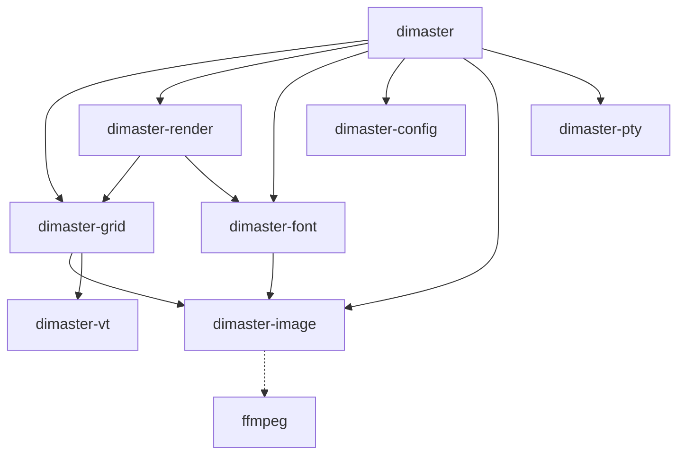
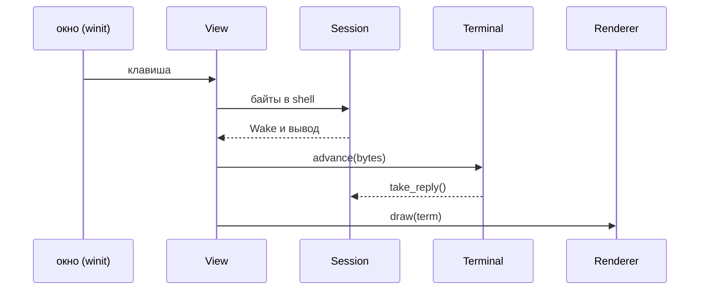
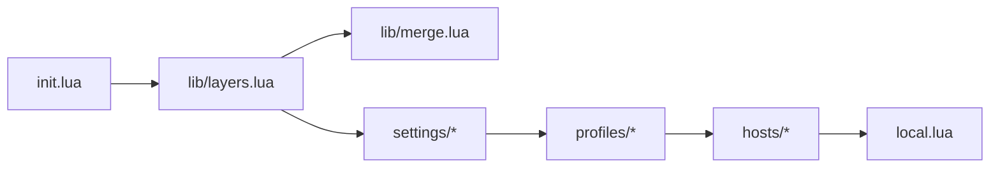
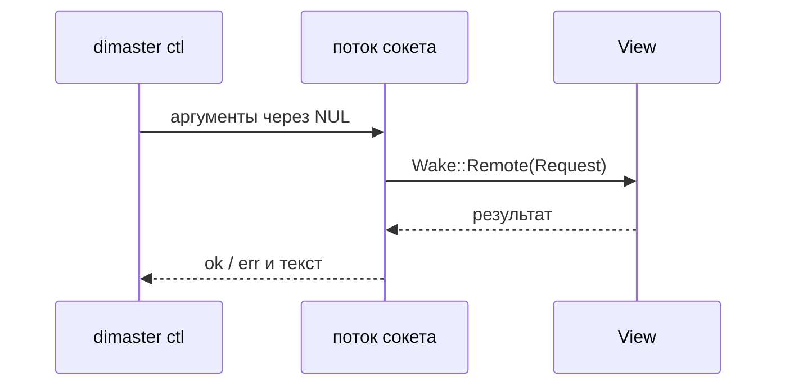

# DimaSter: диаграммы

## Зависимости крейтов



## Классы

```mermaid
classDiagram
    class Parser { +advance(perform, bytes) }
    class Perform {
        <<trait>>
        print(ch)
        execute(byte)
        esc(seq)
        csi(seq)
        osc(data)
        dcs(seq, data)
        apc(data)
    }
    class Sequence { params; intermediates; action }
    class Params { +groups() +get_or(index, default) }
    class Terminal {
        +advance(bytes)
        +resize(size)
        +take_reply()
        +text()
    }
    class State { screen; other; cursor; modes; tabs; title; cwd }
    class Screen { +rows() +history() }
    class Row { cells; wrapped; mark }
    class Cell { ch; extra; style }
    class Style { fg; bg; flags }
    class Cursor { row; col; style }
    class Modes { mouse; synchronized; cursor_shape }
    class KeyboardStack { +current(alternate) }
    class Selection { kind; anchor; head }
    class Span { +contains(line, col) }
    class Selecting { selection; clicks }
    class Clipboard { +set(target, text) +get(target) }
    class Viewport { scroll; selection }
    View *-- Selecting
    View *-- Clipboard
    Selecting o-- Selection
    Terminal ..> Span : span(selection)
    Renderer ..> Viewport
    Viewport o-- Span
    class DefaultColors { foreground; background }
    class Pointer { cell; held }
    State *-- KeyboardStack
    State *-- DefaultColors
    View *-- Pointer
    class Pty { +spawn(command, size) +resize(size) +wait() }
    class App { +resumed() +window_event() +about_to_wait() }
    class View { +start_when_settled() +read_output() +draw() +resize() +key() }
    class Session { +spawn(args, size, wake) +send(bytes) +resize(size) }
    class Renderer { +new() +resize() +draw(term, fonts, scroll) }
    class Builder { +build(term, scroll) }
    class Atlas { +get(fonts, key) +clear() }
    class Pipeline { +upload(queue, upload) }
    class FontSystem { +new(size) +metrics() +set_size(size) +shape(text, bold, italic) +glyph(id, cells) }
    class ShapedGlyph { id; cluster; x; y }
    class Run { text; cells; color }
    class Image { width; height; pixels }
    class Animation { width; height; frames; +frame_at(elapsed) }
    class Store { +picture(animation) +keep(id, picture) }
    class Picture { serial; animation; started }
    class Placement { col; cols; rows; picture }
    class Textures { +prepare(images) +get(image) }
    State *-- Store
    Row *-- Placement
    Placement --> Picture
    Picture *-- Animation
    Renderer *-- Textures
    class Config { font; theme; padding; cursor; scrollback; shell; keys }
    class Theme { foreground; background; cursor; selection; ansi }
    class Binding { key; mods; action }
    class Source { +apply(config_home, config) }
    class Appearance { colors; padding; rtl }
    Config *-- Theme
    Config *-- Binding
    Source ..> Config
    View *-- Config
    class Mode { Normal; Search; Vi; Palette }
    class Animator { +tick(target, effects) +next_frame() }
    class WindowConfig { decorations; opacity; blur; background_image }
    class Effects { cursor_blink; cursor_animation; cursor_trail; smooth_scroll }
    class Label { x; y; text; color }
    View *-- Mode
    View *-- Animator
    Config *-- WindowConfig
    Config *-- Effects
    View ..> Label
    class Plugins { +load(directory) +emit(event) +run(command) +commands() }
    class Server { path }
    class Request { args; reply }
    class Saved { cwd; lines }
    class Launch { args; term_name; directory; socket }
    View *-- Plugins
    class Commands { options; running; history }
    class Finished { command; exit; duration; output }
    class SmartOptions { ok; empty; errors; search_tools }
    class Assist { glow_since; typed }
    class Rect { x; y; width; height; color }
    class Hints { targets; typed }
    class History { entries; selected }
    State *-- Commands
    Commands *-- Finished
    Commands *-- SmartOptions
    View *-- Assist
    class Status { target; facts; line }
    class Sampler { +sample(target) }
    class StatusLine { left; center; right }
    class Segment { text; color; background; rounded }
    class Minimap { origin }
    View *-- Status
    Status ..> Sampler : отдельный поток
    Status *-- StatusLine
    StatusLine *-- Segment
    Plugins ..> StatusLine
    View ..> Rect
    class Layout { lines; logo; image; logo_width }
    class ColorOverrides { palette; foreground; background; cursor }
    State *-- ColorOverrides
    App *-- Server
    Server ..> Request
    Request ..> View
    View ..> Saved
    Session ..> Launch
    Terminal ..> Match : search / link_at
    Renderer *-- Appearance
    FontSystem ..> ShapedGlyph
    FontSystem ..> Image : decode_png
    Builder --> Run
    class Outline { +rasterize() Bitmap }

    App *-- View
    View *-- Terminal
    View *-- Session
    View *-- Renderer
    View *-- FontSystem
    Session *-- Pty
    Renderer *-- Atlas
    Renderer *-- Pipeline
    Renderer ..> Builder
    Builder --> Atlas
    Builder --> FontSystem
    FontSystem ..> Outline

    Terminal *-- Parser
    Terminal *-- State
    Parser ..> Perform
    Perform ..> Sequence
    Sequence --> Params
    State ..|> Perform
    State *-- "2" Screen
    State *-- Cursor
    State *-- Modes
    Screen *-- Row
    Row *-- Cell
    Cell *-- Style
```



## Поток данных



## Слои настроек



## Управление из CLI



## Интеграция с shell

```mermaid
sequenceDiagram
    participant S as zsh / bash / fish
    participant T as Terminal
    participant V as View
    S->>T: OSC 133;A (приглашение)
    S->>T: OSC 633;E;команда, 133;C
    S->>T: вывод
    S->>T: OSC 133;D;код
    T->>T: подсказка, снимок вывода
    V->>T: completed_commands()
    V->>V: свечение, уведомление, событие плагинам
```
